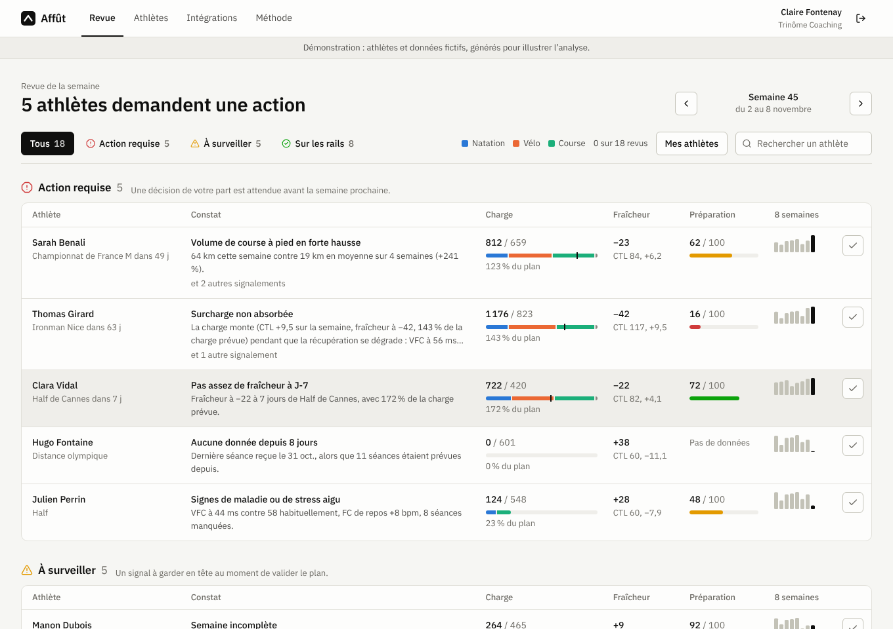
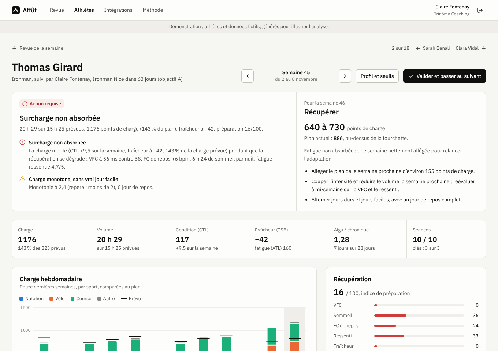

# Affût

**La revue hebdomadaire des entraîneurs de triathlon, déjà triée.**

Affût analyse la semaine d'entraînement de chaque athlète (charge, intensité, fatigue,
récupération, régularité, conformité au plan) et répond aux trois questions que le coach se
pose le dimanche soir : *qui a besoin de moi, pourquoi, et qu'est-ce que j'ajuste pour la
semaine prochaine ?*



## Essayer en deux minutes

Prérequis : Node.js 20.9 ou plus récent. Aucune base de données à installer.

```bash
npm install
```

```bash
npm run dev
```

Ouvrir http://localhost:3000 puis cliquer sur **Explorer la démonstration**
(ou se connecter avec `claire@demo.affut.app` / `demo-affut`).

Sans `DATABASE_URL`, l'application démarre sur une base Postgres embarquée (PGlite) et y
génère une structure fictive de 18 triathlètes avec six mois d'historique. Les données sont
recalées chaque jour sur la semaine qui vient de s'achever : la démo est toujours « à jour ».

## Ce que voit le coach

| Écran | Rôle |
|---|---|
| **Revue** (`/`) | La file de la semaine : athlètes classés *Action requise*, *À surveiller*, *Sur les rails*, avec le constat principal, la charge réalisée contre prévue, la fraîcheur, l'indice de préparation et la tendance sur 8 semaines. Filtres et semaine dans l'URL. |
| **Fiche athlète** (`/athletes/:id`) | Le verdict et ses preuves chiffrées, la fourchette de charge conseillée pour la semaine suivante comparée au plan existant, les courbes (charge par sport, condition, fatigue, fraîcheur), la récupération rapportée à la référence individuelle, les séances prévues contre réalisées, un brouillon de message à l'athlète et la note du coach. « Valider et passer au suivant » enchaîne la revue. |
| **Athlètes** (`/athletes`) | Effectif, seuils, prochain objectif, état de la source de données ; création et profil. |
| **Intégrations** (`/integrations`) | Connecteurs, connexions à réparer, athlètes sans source. |
| **Méthode** (`/methode`) | Chaque indicateur, son calcul et ses seuils, lus directement dans la configuration du moteur. |



Les situations que la démonstration met en scène : progression assimilée, surcharge non
absorbée, signes de maladie, affûtage conforme ou raté, reprise de blessure avec volume de
course qui explose, endurance réalisée trop vite, semaines incomplètes, athlète silencieux,
sport délaissé, sommeil insuffisant, charge monotone, récupération post-course, seuils périmés,
athlète tout juste arrivé.

## Architecture

```
src/
  core/            Moteur d'analyse. Fonctions pures, aucune E/S, aucune dépendance au framework.
    load.ts          charge d'une séance (puissance, allure, FC, ressenti, durée)
    fitness.ts       condition (CTL), fatigue (ATL), fraîcheur (TSB), ratio aigu/chronique, monotonie
    facts.ts         rapprochement prévu/réalisé, références individuelles, indice de préparation
    insights.ts      règles → constats (critique, à surveiller, positif, information)
    recommend.ts     fourchette de charge de la semaine suivante
    message.ts       brouillon de retour à l'athlète
    analyze.ts       orchestrateur : analyzeWeek(données) → WeeklyAnalysis
    config.ts        tous les seuils, au même endroit
  integrations/    Sources de données
    provider.ts      contrat TrainingDataProvider (activités, récupération, plan)
    strava.ts        OAuth 2, séances
    intervals.ts     clé d'API, séances + zones + récupération + plan
    sync.ts          import incrémental idempotent, calcul de charge, invalidation du cache
    crypto.ts        chiffrement AES-256-GCM des jetons, liens signés
    demo/            générateur déterministe du jeu de démonstration
  db/              Schéma Drizzle, connexion (Postgres ou PGlite), démo, CLI
  server/          Authentification, service d'analyse (cache), requêtes cloisonnées par organisation
  app/             Next.js (App Router) : pages, actions serveur, routes API
  components/      Interface, dont les graphiques SVG (survol, clavier, table de données)
drizzle/           Migrations SQL générées
tests/             Moteur, jeu de démonstration, intégration base de données
```

Quelques choix structurants :

- **Le moteur est isolé et déterministe.** `analyzeWeek` reçoit des données et rend un objet :
  il se teste sans base ni serveur, et pourra tourner ailleurs (tâche de fond, export).
  Une semaine passée est analysée telle qu'elle se présentait à sa clôture.
- **Une seule échelle de charge**, recalculée chez nous avec les seuils de l'athlète, quelle
  que soit la plateforme d'origine : deux athlètes sur deux sources restent comparables.
- **Des règles lisibles plutôt qu'une boîte noire.** Chaque constat porte sa preuve chiffrée
  et son seuil ; la page Méthode est générée depuis `config.ts`.
- **Analyses mises en cache** dans `weekly_analyses` : la revue lit des résultats déjà
  calculés ; une analyse n'est recalculée que si les données de l'athlète, la date de clôture
  ou la version du moteur ont changé.
- **Multi-organisation** : chaque requête est bornée par l'organisation de l'utilisateur
  (`orgId`), y compris dans les actions d'écriture. Testé (`tests/service.test.ts`).
- **Même SQL en démo et en production** : PGlite est un vrai Postgres ; le schéma et les
  migrations sont identiques.

## Passer en production

1. Créer une base Postgres (Supabase, Neon, RDS…) et copier `.env.example` vers `.env` :
   `DATABASE_URL`, `APP_URL`, `APP_ENCRYPTION_KEY` (`openssl rand -base64 32`), `CRON_SECRET`.
2. Appliquer les migrations :

   ```bash
   npm run db:migrate
   ```

3. Construire et lancer :

   ```bash
   npm run build
   ```

   ```bash
   npm start
   ```

   ou utiliser le `Dockerfile` fourni (sortie autonome, utilisateur non privilégié, sonde `/api/health`).
4. Planifier la synchronisation, chaque heure :
   `POST /api/cron/sync` avec l'en-tête `Authorization: Bearer $CRON_SECRET`.

Avec `DATABASE_URL`, le mode démonstration est désactivé par défaut. `npm run db:seed` crée
l'organisation de démonstration à la demande (`DEMO_MODE=true` la maintient à jour).

### Connecter de vraies données

- **intervals.icu** : dans le profil de l'athlète, saisir son identifiant et sa clé d'API.
  Importe 180 jours de séances, la récupération et le plan.
- **Strava** : créer une application sur strava.com/settings/api, renseigner
  `STRAVA_CLIENT_ID` et `STRAVA_CLIENT_SECRET`, puis envoyer à l'athlète le lien d'invitation
  affiché dans son profil. Il autorise l'accès lui-même.
- **Autre source** : implémenter `TrainingDataProvider` et l'inscrire dans
  `src/integrations/registry.ts`. La synchronisation, le calcul de charge et l'analyse suivent.

## Vérifications

```bash
npm test
```

```bash
npm run typecheck
```

127 tests : calculs du moteur, 18 scénarios de démonstration vérifiés sur 5 dates d'ancrage
(le diagnostic attendu doit tenir un samedi comme un lundi, en hiver comme en été),
et intégration sur une vraie base (migrations, cache, cloisonnement entre organisations).

## Limites connues

- **Connecteurs Strava et intervals.icu non éprouvés sur les API réelles.** Ils sont écrits
  d'après la documentation des plateformes, sans compte de test : à valider avec un vrai
  compte avant la mise en service. Vérifier aussi les conditions d'utilisation de l'API
  Strava pour un usage de coaching.
- **Pas d'inscription en libre-service** : les organisations et les coachs se créent en base.
  Pas encore de réinitialisation de mot de passe ni d'invitation de coach.
- **Limitation des tentatives de connexion en mémoire**, par processus : à remplacer par un
  compteur partagé derrière plusieurs instances.
- **Pas de saisie manuelle** de séance, de plan ou de questionnaire de récupération : tout
  vient des connecteurs.
- **Seuils du moteur globaux** : pas encore réglables par organisation ou par athlète.
- **Données de santé** : VFC, FC de repos et sommeil sont des données sensibles au sens du
  RGPD. Consentement explicite de l'athlète, hébergement et contrat de sous-traitance sont à
  cadrer avant d'accueillir de vrais athlètes.
- Interface en français uniquement ; pas de pagination de la revue au-delà de quelques
  centaines d'athlètes.
